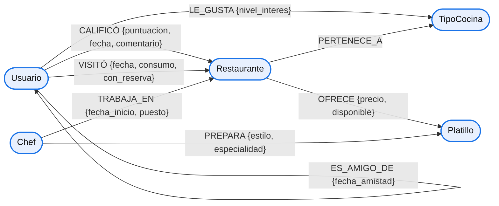

# Documentación Técnica — Sistema de Recomendación de Restaurantes con Neo4j

> **Proyecto:** Sistema de Recomendación de Restaurantes con Neo4j
> **Materia:** Bases de Datos 2
> **Motor:** Neo4j 2026.09.0 (Community Edition)
> **Entregable:** Documentación Técnica

Este documento reúne de forma continua el análisis de requerimientos, el modelo
conceptual de grafos, el diseño del esquema para Neo4j, la configuración del
motor, la implementación física y el catálogo de consultas del sistema.

---

## 1. Propósito y alcance

El objetivo del proyecto es diseñar e implementar en **Neo4j** una base de datos
de grafos para un **sistema de recomendación de restaurantes** que combina las
preferencias individuales de cada usuario con el comportamiento de su círculo
social. Se identifican las entidades (nodos), sus atributos (propiedades) y las
relaciones (aristas) que las conectan, y se construye el **modelo conceptual de
grafos** sobre el que se apoyan las consultas de recomendación y análisis de redes.

El modelo debe ser lo suficientemente expresivo como para responder las consultas
de recomendación, análisis de redes y detección de patrones definidas en el
enunciado.

---

## 2. Análisis de requerimientos del negocio

### 2.1. Descripción del dominio

La plataforma conecta **usuarios** que buscan dónde comer con **restaurantes**
que ofrecen **platillos**, clasificados por **tipos de cocina** y liderados por
**chefs**. El valor del sistema no está en las entidades aisladas, sino en la
**red de relaciones** que se forma entre ellas:

- Usuarios que califican y visitan restaurantes.
- Usuarios que son amigos entre sí (red social).
- Usuarios que declaran preferencia por tipos de cocina.
- Restaurantes que pertenecen a uno o varios tipos de cocina.
- Restaurantes que ofrecen platillos y chefs que trabajan en restaurantes.
- Chefs que preparan platillos.

El negocio desea aprovechar esta red para **recomendar restaurantes** combinando
las preferencias propias del usuario con el comportamiento de su círculo social
(hasta 3 grados de separación).

### 2.2. Objetivos del sistema

| # | Objetivo | Descripción |
| :-: | :--- | :--- |
| O1 | Modelado natural de relaciones | Representar de forma intuitiva las conexiones entre usuarios, restaurantes, chefs, tipos de cocina y platillos. |
| O2 | Consultas eficientes multi-nivel | Recorrer varios niveles de relaciones (amigos de amigos, chefs → restaurantes → platillos) con buen desempeño. |
| O3 | Análisis de redes | Calcular grados de separación entre usuarios (`shortestPath`) e identificar restaurantes altamente conectados. |
| O4 | Recomendaciones inteligentes | Sugerir restaurantes a partir de chefs compartidos, historial de calificaciones y patrones de visita/consumo. |

### 2.3. Reglas de negocio (identificadas del enunciado)

| # | Regla de negocio | Impacto en el modelo |
| :-: | :--- | :--- |
| RN1 | Un usuario puede calificar y visitar múltiples restaurantes. | Cardinalidad N:M entre `Usuario` y `Restaurante` mediante dos relaciones distintas (`CALIFICÓ` y `VISITÓ`). |
| RN2 | Un restaurante puede pertenecer a varios tipos de cocina y ofrecer múltiples platillos. | Relaciones N:M `PERTENECE_A` y `OFRECE`. |
| RN3 | Un chef puede trabajar en varios restaurantes y preparar múltiples platillos. | Relaciones N:M `TRABAJA_EN` y `PREPARA`. |
| RN4 | Las calificaciones deben estar en el rango de 1 a 5 estrellas. | La propiedad `puntuacion` de `CALIFICÓ` debe validarse en `[1,5]`. |
| RN5 | Un restaurante no puede ofrecer el mismo platillo más de una vez. | Unicidad en el par `(Restaurante)-[:OFRECE]->(Platillo)`. |
| RN6 | Recomendar restaurantes según calificaciones altas (≥ 4) de amigos, directos e indirectos, hasta 3 grados de separación, excluyendo restaurantes ya visitados. | Requiere traversal de longitud variable sobre `ES_AMIGO_DE` y filtrado sobre `CALIFICÓ`/`VISITÓ`. |

### 2.4. Supuestos y decisiones de alcance

| # | Supuesto / decisión | Justificación |
| :-: | :--- | :--- |
| S1 | Cada entidad tiene un **identificador lógico** (`*_id`) además de su nombre. | Permite `MERGE` sin duplicados en la carga masiva y claves de negocio estables. |
| S2 | `ES_AMIGO_DE` se modela en **ambos sentidos** para facilitar el traversal. | El enunciado describe amistad recíproca; se documenta como relación dirigida replicada (aunque el traversal puede ignorar la dirección). |
| S3 | `Rango de Precios` se almacena como **categoría discreta** (`Económico`, `Moderado`, `Caro`, `Premium`). | Facilita la consulta de comparación precio declarado vs. consumo real mediante un mapeo categórico → rango esperado. |
| S4 | El consumo real de una visita se almacena en la relación `VISITÓ` (no en el usuario ni en el restaurante). | El consumo depende del par usuario–restaurante–fecha, no de una entidad aislada. |
| S5 | La fecha de amistad se almacena en la relación `ES_AMIGO_DE`. | Propiedad del vínculo, no de los usuarios. |

---

## 3. Identificación de entidades (nodos)

Se identifican **cinco tipos de nodo**. Las etiquetas siguen la convención del
enunciado: **singular y CamelCase**.

### 3.1. `Usuario`

Personas que utilizan la plataforma.

| Propiedad (enunciado) | Nombre técnico | Tipo | Obligatorio | Descripción / dominio |
| :--- | :--- | :--- | :-: | :--- |
| Nombre | `nombre` | String | Sí | Nombre completo del usuario. |
| Email | `email` | String | Sí | Correo electrónico; **único** (clave natural). |
| Edad | `edad` | Integer | Sí | Edad en años (≥ 18). |
| País | `pais` | String | Sí | País de residencia. |
| — (técnico) | `usuario_id` | Integer | Sí | Identificador lógico único (clave de negocio para `MERGE`). |

### 3.2. `Restaurante`

Establecimientos gastronómicos de la plataforma.

| Propiedad (enunciado) | Nombre técnico | Tipo | Obligatorio | Descripción / dominio |
| :--- | :--- | :--- | :-: | :--- |
| Nombre | `nombre` | String | Sí | Nombre del restaurante. |
| Año de Apertura | `anio_apertura` | Integer | Sí | Año en que abrió (p. ej. 1990–2025). |
| Rango de Precios | `rango_precios` | String (enum) | Sí | `Económico`, `Moderado`, `Caro`, `Premium`. |
| Descripción | `descripcion` | String | No | Texto libre descriptivo. |
| — (técnico) | `restaurante_id` | Integer | Sí | Identificador lógico único. |

### 3.3. `TipoCocina`

Categorías gastronómicas.

| Propiedad (enunciado) | Nombre técnico | Tipo | Obligatorio | Descripción / dominio |
| :--- | :--- | :--- | :-: | :--- |
| Nombre del Tipo | `nombre` | String | Sí | P. ej. `Italiana`, `Japonesa`; **único**. |
| Descripción | `descripcion` | String | No | Texto libre descriptivo. |
| — (técnico) | `tipo_cocina_id` | Integer | Sí | Identificador lógico único. |

### 3.4. `Chef`

Personas que lideran la preparación culinaria.

| Propiedad (enunciado) | Nombre técnico | Tipo | Obligatorio | Descripción / dominio |
| :--- | :--- | :--- | :-: | :--- |
| Nombre | `nombre` | String | Sí | Nombre completo del chef. |
| Fecha de Nacimiento | `fecha_nacimiento` | Date | Sí | Formato ISO `YYYY-MM-DD`. |
| Nacionalidad | `nacionalidad` | String | Sí | País de origen. |
| — (técnico) | `chef_id` | Integer | Sí | Identificador lógico único. |

### 3.5. `Platillo`

Preparaciones ofrecidas por los restaurantes.

| Propiedad (enunciado) | Nombre técnico | Tipo | Obligatorio | Descripción / dominio |
| :--- | :--- | :--- | :-: | :--- |
| Nombre | `nombre` | String | Sí | Nombre del platillo. |
| Precio | `precio` | Float | Sí | Precio base de referencia (> 0). |
| Descripción | `descripcion` | String | No | Texto libre descriptivo. |
| — (técnico) | `platillo_id` | Integer | Sí | Identificador lógico único. |

---

## 4. Identificación de relaciones (aristas)

Se identifican **ocho tipos de relación**. La nomenclatura sigue la convención
del enunciado: **mayúsculas con guiones bajos**.

| Relación | Origen → Destino | Cardinalidad | Propiedades | Regla |
| :--- | :--- | :--- | :--- | :--- |
| `CALIFICÓ` | `Usuario` → `Restaurante` | N:M | `puntuacion` (1–5), `fecha`, `comentario` | RN1, RN4 |
| `VISITÓ` | `Usuario` → `Restaurante` | N:M | `fecha`, `consumo`, `con_reserva` | RN1 |
| `ES_AMIGO_DE` | `Usuario` → `Usuario` | N:M | `fecha_amistad` | RN6 |
| `PERTENECE_A` | `Restaurante` → `TipoCocina` | N:M | — | RN2 |
| `OFRECE` | `Restaurante` → `Platillo` | N:M | `precio`, `disponible` | RN2, RN5 |
| `PREPARA` | `Chef` → `Platillo` | N:M | `estilo`, `especialidad` | RN3 |
| `TRABAJA_EN` | `Chef` → `Restaurante` | N:M | `fecha_inicio`, `puesto` | RN3 |
| `LE_GUSTA` | `Usuario` → `TipoCocina` | N:M | `nivel_interes` (1–5) | RN6 (perfil declarado) |

### 4.1. Detalle de propiedades de las relaciones

| Relación | Propiedad | Tipo | Obligatorio | Descripción / dominio |
| :--- | :--- | :--- | :-: | :--- |
| `CALIFICÓ` | `puntuacion` | Integer | Sí | Estrellas de 1 a 5 (RN4). |
| `CALIFICÓ` | `fecha` | Date | Sí | Fecha de la calificación. |
| `CALIFICÓ` | `comentario` | String | No | Texto libre del usuario. |
| `VISITÓ` | `fecha` | Date | Sí | Fecha de la visita. |
| `VISITÓ` | `consumo` | Float | Sí | Monto consumido (moneda de la plataforma). |
| `VISITÓ` | `con_reserva` | Boolean | Sí | `true` si la visita se hizo con reserva. |
| `ES_AMIGO_DE` | `fecha_amistad` | Date | Sí | Fecha desde la que son amigos. |
| `OFRECE` | `precio` | Float | Sí | Precio de ese platillo en ese restaurante. |
| `OFRECE` | `disponible` | Boolean | Sí | `true` si está actualmente disponible. |
| `PREPARA` | `estilo` | String | No | Estilo de preparación del chef. |
| `PREPARA` | `especialidad` | Boolean | No | `true` si el chef es especialista en ese platillo. |
| `TRABAJA_EN` | `fecha_inicio` | Date | Sí | Fecha de inicio en el restaurante. |
| `TRABAJA_EN` | `puesto` | String | No | Cargo (p. ej. `Chef Ejecutivo`, `Sous Chef`). |
| `LE_GUSTA` | `nivel_interes` | Integer | Sí | Interés declarado de 1 a 5. |

---

## 5. Modelo conceptual de grafos

### 5.1. Diagrama conceptual



Leyenda: cada nodo representa una **entidad**; cada arco una **relación dirigida**
con sus **propiedades**. El grafo es **heterogéneo** (nodos de distinto tipo) y
**mixto** en dirección (relaciones entre entidades distintas y autorrelación
`ES_AMIGO_DE`).

### 5.2. Lectura del modelo (patrones de traversal relevantes)

| Patrón de traversal | Relaciones implicadas | Consulta de negocio soportada |
| :--- | :--- | :--- |
| `Usuario -[:ES_AMIGO_DE*1..3]-> Usuario -[:CALIFICÓ]-> Restaurante` | Amistad + Calificación | Recomendación social (Q1). |
| `Chef -[:TRABAJA_EN]-> Restaurante <-[:CALIFICÓ]- Usuario` y `Chef -[:PREPARA]-> Platillo <-[:OFRECE]- Restaurante` | Trabajo, preparación, oferta | Chefs de alto impacto (Q2). |
| `Usuario -[:VISITÓ]-> Restaurante` (agregación `con_reserva`, `puntuación`) | Visita + Calificación | Restaurantes infravalorados (Q3). |
| `Restaurante -[:VISITÓ|VISITÓ]-`... `(consumo)` vs `rango_precios` | Visita + atributo del restaurante | Precio declarado vs. consumo real (Q4). |
| `Usuario -[:LE_GUSTA]-> TipoCocina` vs `Usuario -[:VISITÓ]-> Restaurante -[:PERTENECE_A]-> TipoCocina` | Preferencia declarada vs. comportamiento | Discrepancia cocina declarada vs. visitada (Q5). |
| `Usuario -[:ES_AMIGO_DE*]-> Usuario` (`shortestPath`) | Amistad | Grados de separación (N1). |
| `Restaurante <-[:TRABAJA_EN]- Chef` + `Restaurante -[:OFRECE]-> Platillo` | Trabajo + oferta | Restaurantes altamente conectados (N2). |

---

## 6. Justificación del enfoque de grafos

| Necesidad del negocio | Ventaja del modelo de grafos |
| :--- | :--- |
| Recomendación basada en amigos a 3 grados | `ES_AMIGO_DE*1..3` expresa el traversal de longitud variable en una sola cláusula. |
| Chefs que conectan restaurantes y platillos | El traversal `Chef → Restaurante → ... → Platillo` es natural y de costo proporcional al vecindario. |
| Comparar preferencia declarada vs. comportamiento | Dos caminos alternativos desde `Usuario` (`LE_GUSTA` vs `VISITÓ→PERTENECE_A`) se contrastan sin `JOIN`s. |
| Grados de separación | `shortestPath` sobre la red social es un algoritmo nativo del grafo. |
| Datos heterogéneos y en evolución | El modelo *schema-less* añade propiedades y relaciones sin migraciones. |

El modelo relacional exigiría múltiples tablas puente, `JOIN`s de N niveles y
recursividad SQL para las mismas consultas; el grafo lo expresa de forma directa.

---

## 7. Catálogo conceptual de consultas de negocio

En esta sección se define **qué debe responder el sistema**; el diseño de los
patrones Cypher se detalla en el apartado de consultas (§12). Se distinguen 5
consultas obligatorias (Q1–Q5) y 2 análisis de redes (N1–N2).

### 7.1. Consultas obligatorias

| ID | Consulta | Datos de entrada | Resultado esperado | Reglas |
| :-: | :--- | :--- | :--- | :--- |
| **Q1** | Recomendar restaurantes según calificaciones altas (≥ 4) de amigos directos e indirectos (hasta 3 grados), excluyendo los ya visitados. | `email` (o `usuario_id`) | Restaurantes ordenados por nº de amigos coincidentes y calificación promedio de esos amigos. | RN6 |
| **Q2** | Identificar chefs de alto impacto: trabajan en restaurantes con calificación promedio > 4 y sus platillos se ofrecen en ≥ 3 restaurantes distintos. | — (global) | Lista de chefs con métricas (`prom_restaurantes`, `num_restaurantes_platillos`). | RN3 |
| **Q3** | Encontrar restaurantes infravalorados: tasa de visitas con reserva > promedio general, pero calificación promedio < promedio general. | — (global) | Restaurantes con `tasa_reserva`, `prom_rating`, referencias a promedios globales. | RN1 |
| **Q4** | Comparar el rango de precios declarado contra el consumo promedio real de sus visitas; hallar mayor diferencia. | — (global) | Restaurantes ordenados por diferencia (`consumo_real − consumo_esperado`). | RN1, S3 |
| **Q5** | Detectar discrepancia entre el tipo de cocina favorito declarado (`LE_GUSTA` máximo) y el realmente visitado más frecuente (`VISITÓ→PERTENECE_A`). | — (global) | Usuarios con `cocina_declarada`, `cocina_real` y bandera de discrepancia. | RN2 |

### 7.2. Análisis de redes

| ID | Análisis | Método | Resultado esperado |
| :-: | :--- | :--- | :--- |
| **N1** | Rutas más cortas entre usuarios (grados de separación). | `shortestPath` sobre `ES_AMIGO_DE`. | Longitud del camino (nº de saltos) y camino entre dos usuarios. |
| **N2** | Restaurantes altamente conectados (más chefs y platillos destacados). | Grado de entrada/salida sobre `TRABAJA_EN` y `OFRECE`. | Ranking de restaurantes con `num_chefs` y `num_platillos`. |

### 7.3. Preguntas de negocio → elementos del modelo

| Consulta | Nodos usados | Relaciones usadas | Propiedades clave |
| :-: | :--- | :--- | :--- |
| Q1 | `Usuario`, `Restaurante` | `ES_AMIGO_DE`, `CALIFICÓ`, `VISITÓ` | `puntuacion`, `email` |
| Q2 | `Chef`, `Restaurante`, `Platillo` | `TRABAJA_EN`, `PREPARA`, `OFRECE`, `CALIFICÓ` | `puntuacion` |
| Q3 | `Restaurante`, `Usuario` | `VISITÓ`, `CALIFICÓ` | `con_reserva`, `puntuacion` |
| Q4 | `Restaurante`, `Usuario` | `VISITÓ` | `rango_precios`, `consumo` |
| Q5 | `Usuario`, `TipoCocina`, `Restaurante` | `LE_GUSTA`, `VISITÓ`, `PERTENECE_A` | `nivel_interes` |
| N1 | `Usuario` | `ES_AMIGO_DE` | — |
| N2 | `Restaurante`, `Chef`, `Platillo` | `TRABAJA_EN`, `OFRECE` | — |

---

## 8. Trazabilidad requerimiento → modelo

| Requerimiento del enunciado | Cubierto por |
| :--- | :--- |
| Modelado natural de relaciones | Secciones 3, 4 y 5 (5 nodos, 8 relaciones, propiedades en nodos y aristas). |
| Consultas eficientes multi-nivel | Patrones de traversal (§5.2) y catálogo de consultas (§7). |
| Análisis de redes | N1 (`shortestPath`) y N2 (restaurantes conectados). |
| Recomendaciones inteligentes | Q1 (social), Q2 (chefs), Q4/Q5 (patrones de consumo). |
| Reglas de negocio | §2.3 y su mapeo en §4. |
| Convenciones de nombres | Etiquetas singular/CamelCase; relaciones MAYÚSCULAS_CON_GUIONES. |

---

## 9. Diseño del esquema de grafos para Neo4j

Esta sección transforma el modelo conceptual en un **esquema implementable en
Neo4j 5.x**: etiquetas de nodo, propiedades con tipos concretos, tipos de relación
y decisiones orientadas a las consultas de negocio.

### 9.1. Convenciones de nomenclatura

| Elemento | Convención | Ejemplos |
| :--- | :--- | :--- |
| Etiqueta de nodo | Singular, **CamelCase** | `Usuario`, `Restaurante`, `TipoCocina`, `Chef`, `Platillo` |
| Tipo de relación | **MAYÚSCULAS_CON_GUIONES_BAJOS** | `CALIFICÓ`, `VISITÓ`, `ES_AMIGO_DE`, `PERTENECE_A`, `OFRECE`, `PREPARA`, `TRABAJA_EN`, `LE_GUSTA` |
| Propiedad | **snake_case**, sin acentos | `usuario_id`, `anio_apertura`, `fecha_nacimiento`, `nivel_interes` |
| Constraint / índice | Prefijo por tipo | `uniq_usuario_id`, `idx_restaurante_nombre` |

### 9.2. Esquema de nodos

Tipos de datos Neo4j: `STRING`, `INTEGER`, `FLOAT`, `BOOLEAN`, `DATE`. Toda fecha
se almacena como escalar `date('YYYY-MM-DD')`.

**`Usuario`**

| Propiedad | Tipo Neo4j | Obligatoria | Clave | Descripción |
| :--- | :--- | :-: | :--- | :--- |
| `usuario_id` | INTEGER | Sí | **Único** | Identificador lógico (`MERGE`). |
| `nombre` | STRING | Sí | | Nombre completo. |
| `email` | STRING | Sí | **Único** | Clave natural; formato válido. |
| `edad` | INTEGER | Sí | | ≥ 18. |
| `pais` | STRING | Sí | | País de residencia. |

**`Restaurante`**

| Propiedad | Tipo Neo4j | Obligatoria | Clave | Descripción |
| :--- | :--- | :-: | :--- | :--- |
| `restaurante_id` | INTEGER | Sí | **Único** | Identificador lógico. |
| `nombre` | STRING | Sí | Índice | Nombre del restaurante. |
| `anio_apertura` | INTEGER | Sí | | Año de apertura. |
| `rango_precios` | STRING (enum) | Sí | Índice | `Económico` \| `Moderado` \| `Caro` \| `Premium`. |
| `descripcion` | STRING | No | | Texto libre. |

**`TipoCocina`**

| Propiedad | Tipo Neo4j | Obligatoria | Clave | Descripción |
| :--- | :--- | :-: | :--- | :--- |
| `tipo_cocina_id` | INTEGER | Sí | **Único** | Identificador lógico. |
| `nombre` | STRING | Sí | **Único** | Nombre del tipo (clave natural). |
| `descripcion` | STRING | No | | Texto libre. |

**`Chef`**

| Propiedad | Tipo Neo4j | Obligatoria | Clave | Descripción |
| :--- | :--- | :-: | :--- | :--- |
| `chef_id` | INTEGER | Sí | **Único** | Identificador lógico. |
| `nombre` | STRING | Sí | | Nombre completo. |
| `fecha_nacimiento` | DATE | Sí | | Fecha de nacimiento. |
| `nacionalidad` | STRING | Sí | | País de origen. |

**`Platillo`**

| Propiedad | Tipo Neo4j | Obligatoria | Clave | Descripción |
| :--- | :--- | :-: | :--- | :--- |
| `platillo_id` | INTEGER | Sí | **Único** | Identificador lógico. |
| `nombre` | STRING | Sí | | Nombre del platillo. |
| `precio` | FLOAT | Sí | | Precio base de referencia (> 0). |
| `descripcion` | STRING | No | | Texto libre. |

### 9.3. Esquema de relaciones

| Relación | Patrón | Propiedades (tipo) | Cardinalidad |
| :--- | :--- | :--- | :--- |
| `CALIFICÓ` | `(:Usuario)-[:CALIFICÓ]->(:Restaurante)` | `puntuacion` (INTEGER 1–5), `fecha` (DATE), `comentario` (STRING, opc.) | N:M |
| `VISITÓ` | `(:Usuario)-[:VISITÓ]->(:Restaurante)` | `fecha` (DATE), `consumo` (FLOAT), `con_reserva` (BOOLEAN) | N:M |
| `ES_AMIGO_DE` | `(:Usuario)-[:ES_AMIGO_DE]->(:Usuario)` | `fecha_amistad` (DATE) | N:M |
| `PERTENECE_A` | `(:Restaurante)-[:PERTENECE_A]->(:TipoCocina)` | — | N:M |
| `OFRECE` | `(:Restaurante)-[:OFRECE]->(:Platillo)` | `precio` (FLOAT), `disponible` (BOOLEAN) | N:M |
| `PREPARA` | `(:Chef)-[:PREPARA]->(:Platillo)` | `estilo` (STRING), `especialidad` (BOOLEAN) | N:M |
| `TRABAJA_EN` | `(:Chef)-[:TRABAJA_EN]->(:Restaurante)` | `fecha_inicio` (DATE), `puesto` (STRING) | N:M |
| `LE_GUSTA` | `(:Usuario)-[:LE_GUSTA]->(:TipoCocina)` | `nivel_interes` (INTEGER 1–5) | N:M |

Todas las relaciones se modelan **dirigidas**. `ES_AMIGO_DE` se interpreta como
amistad recíproca y, para robustez del traversal, se generan **ambos arcos**
(`A→B` y `B→A`) en la carga; `PERTENECE_A` no lleva propiedades (relación pura de
clasificación).

### 9.4. Mapeo conceptual → físico

| Concepto (modelo conceptual) | Implementación (Neo4j) |
| :--- | :--- |
| Entidad | Etiqueta de nodo + propiedades |
| Relación con atributos | Tipo de relación + propiedades de relación |
| Identificador de entidad | Propiedad `*_id` con constraint `UNIQUE` (`MERGE`) |
| Clave natural | `Usuario.email`, `TipoCocina.nombre` (`UNIQUE`) |
| Regla "un restaurante no ofrece dos veces el mismo platillo" | `MERGE (:Restaurante {id})-[:OFRECE]->(:Platillo {id})` |
| Rango de precios categórico | Propiedad `rango_precios` (enum) + mapeo a consumo esperado en Q4 |

### 9.5. Decisiones de diseño orientadas a las consultas

| # | Decisión | Consulta beneficiada | Motivo |
| :-: | :--- | :--- | :--- |
| D1 | Dos relaciones separadas `CALIFICÓ` y `VISITÓ`. | Q1, Q3, Q4, Q5 | Calificación y visita tienen atributos y semántica distintos. |
| D2 | `puntuacion` como propiedad de `CALIFICÓ`. | Q1, Q2, Q3 | Permite agregaciones por par usuario–restaurante. |
| D3 | `con_reserva` y `consumo` en `VISITÓ`. | Q3, Q4 | Son atributos del evento de visita. |
| D4 | `ES_AMIGO_DE` replicada en ambos sentidos. | Q1, N1 | `shortestPath` y el traversal `*1..3` funcionan en cualquier dirección. |
| D5 | `rango_precios` como enum con mapeo a consumo esperado. | Q4 | Calcula `consumo_real − consumo_esperado` sin tabla auxiliar. |
| D6 | Índices en `Restaurante.nombre` y `Chef.nacionalidad`. | búsquedas puntuales | Acelera filtros y selecciones concretas. |
| D7 | Constraints `UNIQUE` en todos los `*_id`. | Carga masiva | Habilita `MERGE` sin duplicados y acelera la carga. |
| D8 | `PERTENECE_A` sin propiedades. | Q5 | Es una clasificación pura; mantiene el grafo limpio. |

---

## 10. Constraints, índices e implementación física

El esquema físico se implementa con los scripts `ddl/01_constraints.cypher` y
`ddl/02_indexes.cypher`, ejecutados sobre la base `neo4j`.

### 10.1. Constraints de unicidad (7, aplicados)

| Nombre | Tipo | Etiqueta | Propiedad |
| :--- | :--- | :--- | :--- |
| `uniq_usuario_id` | UNICIDAD | `Usuario` | `usuario_id` |
| `uniq_usuario_email` | UNICIDAD | `Usuario` | `email` |
| `uniq_restaurante_id` | UNICIDAD | `Restaurante` | `restaurante_id` |
| `uniq_chef_id` | UNICIDAD | `Chef` | `chef_id` |
| `uniq_platillo_id` | UNICIDAD | `Platillo` | `platillo_id` |
| `uniq_tipococina_id` | UNICIDAD | `TipoCocina` | `tipo_cocina_id` |
| `uniq_tipococina_nombre` | UNICIDAD | `TipoCocina` | `nombre` |

### 10.2. Índices secundarios (10, aplicados)

| Índice | Etiqueta / Relación | Propiedad |
| :--- | :--- | :--- |
| `idx_restaurante_nombre` | `Restaurante` | `nombre` |
| `idx_restaurante_rango` | `Restaurante` | `rango_precios` |
| `idx_restaurante_anio` | `Restaurante` | `anio_apertura` |
| `idx_chef_nacionalidad` | `Chef` | `nacionalidad` |
| `idx_usuario_pais` | `Usuario` | `pais` |
| `idx_platillo_precio` | `Platillo` | `precio` |
| `idx_califico_puntuacion` | `CALIFICÓ` | `puntuacion` |
| `idx_visito_fecha` | `VISITÓ` | `fecha` |
| `idx_visito_reserva` | `VISITÓ` | `con_reserva` |
| `idx_trabajaen_puesto` | `TRABAJA_EN` | `puesto` |

### 10.3. Reglas de negocio no declarativas

| Regla | Estrategia de integridad |
| :--- | :--- |
| RN4 — puntuación ∈ [1,5] | Validación en la generación de datos y filtros `WHERE` en las consultas. |
| RN5 — unicidad `(Restaurante)-[:OFRECE]->(Platillo)` | `MERGE` sobre el patrón completo en la carga. |
| Existencia de propiedades obligatorias | `IS NOT NULL` — exclusivo de Neo4j **Enterprise** (no aplica en Community). |

### 10.4. Evidencia de verificación

| Verificación | Comando | Resultado |
| :--- | :--- | :--- |
| Conectividad | `RETURN 1` | `ok = 1` |
| Constraints activos | `SHOW CONSTRAINTS` | **7** (todos `ONLINE`) |
| Índices activos | `SHOW INDEXES` | **17** (10 explícitos + 7 de respaldo, `ONLINE`) |
| Import montado | `ls /import` | Visible y en **solo lectura** |
| `LOAD CSV` operativo | `LOAD CSV ... FROM 'file:///_smoke.csv'` | Lee el archivo correctamente |

---

## 11. Configuración del entorno e implementación física

### 11.1. Entorno y versiones

| Componente | Versión / valor |
| :--- | :--- |
| Motor | Neo4j Kernel **2026.09.0** (Community Edition) |
| Lenguaje | Cypher 5.25 |
| Contenedor | Docker 29.9.0 + Docker Compose v5.6.0 (`neo4j:latest`) |
| Base de datos | `neo4j` (por defecto) |
| Usuario / contraseña | `neo4j` / `admin123` |
| Bolt | `bolt://localhost:7687` |
| HTTP / Browser | `http://localhost:7474` |
| Plugins | APOC habilitado |

### 11.2. Estructura del proyecto

```
Segundo Proyecto/
├── data/                      # CSVs de carga, montado en /import (solo lectura)
├── ddl/
│   ├── 00_reset.cypher        # Vaciar la base (desarrollo)
│   ├── 01_constraints.cypher  # Constraints de unicidad
│   └── 02_indexes.cypher      # Índices secundarios
├── docker/
│   └── docker-compose.yml     # Definición del contenedor Neo4j
├── documentacion/
│   └── Documentación Técnica.md
└── src/
    └── main.py                # Conexión de prueba vía neo4j-driver
```

### 11.3. Configuración de Neo4j (`docker/docker-compose.yml`)

| Ajuste | Valor | Motivo |
| :--- | :--- | :--- |
| `NEO4J_AUTH` | `neo4j/admin123` | Credenciales del proyecto (mínimo 8 caracteres). |
| `NEO4J_PLUGINS` | `["apoc"]` | Requerido por el MCP de Neo4j. |
| Heap inicial / máximo | `512m` / `2G` | Memoria de la JVM para consultas de agregación. |
| Page cache | `1G` | Caché de páginas del grafo. |
| `allow_csv_import_from_file_urls` | `true` | Permite `LOAD CSV` desde `file:///`. |
| `NEO4J_server_directories_import` | `/import` | Directorio de importación de los CSV. |
| Volumen `neo4j_data` → `/data` | Named volume | Persistencia de la base entre reinicios. |
| Bind `../data` → `/import:ro` | Solo lectura | CSVs visibles al contenedor **sin** modificar su dueño. |

> **Nota de diseño:** la carpeta de importación se monta **solo lectura** en
> `/import`. El `entrypoint` de la imagen Neo4j solo chown-ea su *home*
> (`/var/lib/neo4j`) y `/data`; al usar `/import` como ruta personalizada se evita
> que el host pierda la propiedad de los archivos CSV.

### 11.4. Puesta en marcha

```bash
cd docker
docker compose up -d
docker exec neo4j cypher-shell -u neo4j -p admin123 "RETURN 1 AS ok;"
```

### 11.5. Aplicación del esquema

```bash
docker exec -i neo4j cypher-shell -u neo4j -p admin123 < ddl/01_constraints.cypher
docker exec -i neo4j cypher-shell -u neo4j -p admin123 < ddl/02_indexes.cypher
```

### 11.6. Reproducción desde cero

```bash
cd docker && docker compose up -d
cd ..
docker exec -i neo4j cypher-shell -u neo4j -p admin123 < ddl/00_reset.cypher
docker exec -i neo4j cypher-shell -u neo4j -p admin123 < ddl/01_constraints.cypher
docker exec -i neo4j cypher-shell -u neo4j -p admin123 < ddl/02_indexes.cypher
```

---

## 12. Diseño de las consultas en Cypher (patrones)

Diseño de alto nivel (patrón y cláusulas previstas) de las 5 consultas
obligatorias (Q1–Q5) y los 2 análisis de red (N1–N2).

### 12.1. Mapeo `rango_precios` → consumo esperado (Q4)

| `rango_precios` | Consumo esperado (referencia) |
| :--- | ---: |
| `Económico` | 100 |
| `Moderado` | 250 |
| `Caro` | 500 |
| `Premium` | 900 |

### Q1 — Recomendación social (amigos hasta 3 grados)

```cypher
MATCH (u:Usuario {email: $email})-[:ES_AMIGO_DE*1..3]-(amigo:Usuario)
MATCH (amigo)-[c:CALIFICÓ]->(r:Restaurante)
WHERE c.puntuacion >= 4
  AND NOT (u)-[:VISITÓ]->(r)
RETURN r.nombre,
       count(DISTINCT amigo) AS amigos_coincidentes,
       avg(c.puntuacion)     AS calificacion_prom
ORDER BY amigos_coincidentes DESC, calificacion_prom DESC;
```

### Q2 — Chefs de alto impacto

```cypher
MATCH (chef:Chef)-[:TRABAJA_EN]->(r:Restaurante)<-[c:CALIFICÓ]-(:Usuario)
WITH chef, r, avg(c.puntuacion) AS prom_r
WHERE prom_r > 4
MATCH (chef)-[:PREPARA]->(p:Platillo)<-[:OFRECE]-(otro:Restaurante)
RETURN chef.nombre, count(DISTINCT otro) AS restaurantes_platillo
ORDER BY restaurantes_platillo DESC;
```

### Q3 — Restaurantes infravalorados

```cypher
MATCH (r:Restaurante)<-[v:VISITÓ]-(:Usuario)
WITH r, avg(CASE WHEN v.con_reserva THEN 1.0 ELSE 0.0 END) AS tasa_reserva
// rating por restaurante + promedios globales en WITH posterior;
// devolver restaurantes con tasa_reserva > prom_global_reserva
//   AND rating < prom_global_rating
```

### Q4 — Precio declarado vs. consumo real

```cypher
MATCH (r:Restaurante)<-[v:VISITÓ]-(:Usuario)
WITH r, avg(v.consumo) AS consumo_real
WITH r, consumo_real,
     CASE r.rango_precios
       WHEN 'Económico' THEN 100.0
       WHEN 'Moderado'  THEN 250.0
       WHEN 'Caro'      THEN 500.0
       WHEN 'Premium'   THEN 900.0
       ELSE 0.0 END AS consumo_esperado
RETURN r.nombre, r.rango_precios, consumo_real, consumo_esperado,
       (consumo_real - consumo_esperado) AS diferencia
ORDER BY diferencia DESC;
```

### Q5 — Cocina declarada vs. realmente visitada

```cypher
// (1) cocina declarada favorita: u-[:LE_GUSTA]->t (mayor nivel_interes)
// (2) cocina realmente visitada: u-[:VISITÓ]->r-[:PERTENECE_A]->t contada
// comparar y marcar discrepancia cuando no coinciden
```

### N1 — Ruta más corta entre usuarios

```cypher
MATCH (a:Usuario {email: $a}), (b:Usuario {email: $b}),
      p = shortestPath((a)-[:ES_AMIGO_DE*..10]-(b))
RETURN length(p) AS grados_de_separacion, [n IN nodes(p) | n.nombre] AS camino;
```

### N2 — Restaurantes altamente conectados

```cypher
MATCH (r:Restaurante)
OPTIONAL MATCH (r)<-[:TRABAJA_EN]-(c:Chef)
OPTIONAL MATCH (r)-[:OFRECE]->(p:Platillo)
RETURN r.nombre, count(DISTINCT c) AS num_chefs, count(DISTINCT p) AS num_platillos
ORDER BY (count(DISTINCT c) + count(DISTINCT p)) DESC;
```

---

## 13. Conclusiones

1. El dominio se representa de forma natural con **5 tipos de nodo** y
   **8 tipos de relación**, con propiedades en nodos y aristas, cubriendo las
   **6 reglas de negocio** del enunciado.
2. El esquema Neo4j queda implementado con **7 constraints** de unicidad y
   **10 índices** secundarios, todos `ONLINE`, sobre Neo4j 2026.09.0 Community.
3. Las **5 consultas obligatorias** y los **2 análisis de redes** son expresables
   como patrones de traversal multi-nivel, lo que valida la idoneidad del enfoque
   de grafos frente a un modelo relacional.
4. El entorno es reproducible vía Docker Compose y la carpeta de importación
   (`/import`, solo lectura) habilita la carga masiva con `LOAD CSV`.

---
